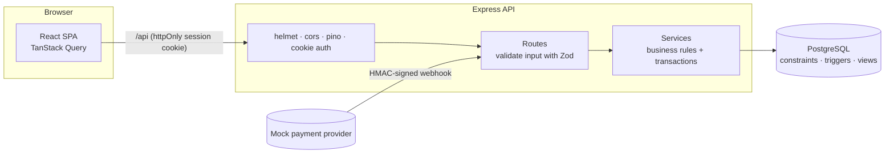
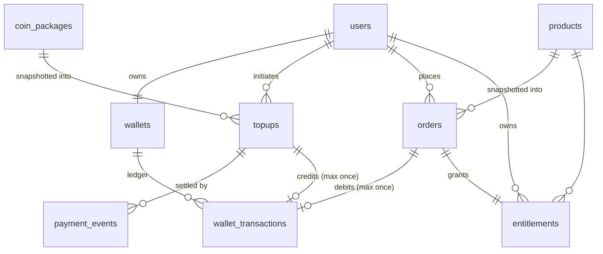
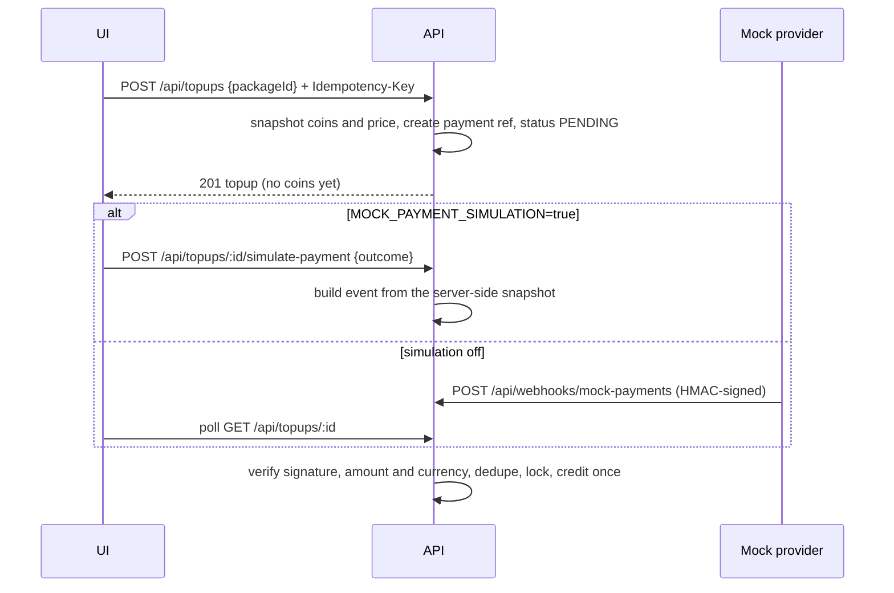

# Coin Vault

A virtual-currency marketplace for a gaming store. Players buy **Gold Coins** with real money (through a mocked payment provider) and spend them on digital goods: **skins**, **emotes** and **battle passes**.

The interesting part is what happens underneath. Every coin that moves is recorded in an append-only ledger, and every money-moving request is safe to retry. Concurrent requests cannot overdraw a wallet, double-credit a payment or grant the same item twice. Each of these guarantees is enforced by the database and proven by an integration test against real PostgreSQL.

| Layer    | Tech                                                                      |
| -------- | ------------------------------------------------------------------------- |
| Frontend | React 19, Vite, TypeScript, TanStack Query, React Router                  |
| Backend  | Node.js, Express 5, TypeScript, Zod, Pino                                 |
| Database | PostgreSQL 16 (Docker), Prisma 7 ORM with the `pg` driver adapter         |
| Testing  | Vitest + Supertest against a real Postgres; React Testing Library         |
| CI       | GitHub Actions: lint, typecheck, test and build on every push and PR      |

---

## Contents

- [Quick start](#quick-start)
- [The user journey](#the-user-journey)
- [Architecture](#architecture)
- [Data model](#data-model)
- [How correctness is guaranteed](#how-correctness-is-guaranteed)
- [Payments](#payments)
- [API reference](#api-reference)
- [Testing](#testing)
- [Continuous integration](#continuous-integration)
- [Configuration](#configuration)
- [Project structure](#project-structure)
- [Requirements traceability](#requirements-traceability)
- [Assumptions and trade-offs](#assumptions-and-trade-offs)
- [Future work](#future-work)

---

## Quick start

**Prerequisites:** Node.js 22+, Docker.

```bash
# 1. Start Postgres (host port 5433; also creates the coinvault_test database)
docker compose up -d

# 2. API: install, migrate, seed, run on http://localhost:4000
cd server
cp .env.example .env
npm install            # also generates the Prisma client
npm run db:migrate
npm run db:seed
npm run dev

# 3. Web app, in a second terminal: http://localhost:5173
cd client
npm install
npm run dev
```

Open <http://localhost:5173>, create an account, buy a coin package (choose **Pay** in the mock checkout), then buy something in the store.

### Running the whole stack in containers (optional)

```bash
docker compose --profile app up -d --build   # web app on http://localhost:8080
docker compose --profile app down            # stop (add -v to also delete the database volume)
```

This builds the images locally, runs migrations and the seed in a one-off container, then starts the API (`NODE_ENV=production`) and an nginx container that serves the SPA and proxies `/api`.

---

## The user journey

The PRD's success criterion is the full loop below, with no manual database work:

> **Register → Buy Gold Coins → See updated balance → Browse products → Purchase → See reduced balance → See the item in inventory.**

| Screen        | What it does                                                                                     |
| ------------- | ------------------------------------------------------------------------------------------------ |
| **Store**     | Active products with category filters (in the URL, so they can be shared). Owned items are marked. |
| **Buy Coins** | Active coin packages. Opens a mock checkout where the user picks success or failure.             |
| **Inventory** | Owned items, with seasonal validity for battle passes.                                           |
| **History**   | Three tabs: the coin ledger, purchases and payment attempts. Each uses cursor pagination.        |

The balance in the header updates after every top-up and purchase.

---

## Architecture



The backend is organised **by feature module**, and each module has the same three layers:

- **`*.routes.ts`** handles HTTP only. It parses and validates input, reads the authenticated user, and shapes the response.
- **`*.service.ts`** holds the business rules, transactions and mapping to response views. It has no Express types.
- **Prisma** handles data access. The generated client is fully typed against `schema.prisma`.

A few cross-cutting pieces sit outside the modules:

- **`AppError`** carries a stable, machine-readable `code` (for example `INSUFFICIENT_FUNDS`). Clients branch on `code`, never on the message. One error handler maps errors to the envelope `{ "error": { "code", "message", "details?" } }` and hides internals behind a generic 500.
- **Config** (`src/config.ts`) validates every environment variable with Zod at boot. The process refuses to start with a missing or weak secret.
- **Production hardening:**
  - Helmet security headers and a strict CORS origin.
  - Rate limiting on login and registration.
  - Request body size limits.
  - Structured JSON logs that redact credentials.
  - A `/api/health` endpoint that checks the database.
  - Graceful shutdown that drains in-flight requests and closes the pool.

---

## Data model



| Table                 | Purpose                                                                                                                       |
| --------------------- | ----------------------------------------------------------------------------------------------------------------------------- |
| `users`               | Account. Email is stored lowercased (enforced by a CHECK) and unique. Only a bcrypt hash of the password is stored.           |
| `wallets`             | One per user, created in the same transaction as the user. `balance` is a cached sum of the ledger and can never go below zero. |
| `wallet_transactions` | **Immutable ledger.** One row per balance change: signed `amount`, `balance_after`, and a link to the top-up *or* order that caused it. |
| `coin_packages`       | What can be bought with real money. Prices are integer **minor units** (paise), never floats.                                 |
| `topups`              | A coin purchase attempt. It snapshots the coins and price when initiated and tracks `payment_status` and `credited_at`.       |
| `payment_events`      | Every provider event received, unique by provider event id. Gives an audit trail and makes redelivery a no-op.                |
| `products`            | Catalog item with a category, coin price and active flag. Battle passes also carry season fields.                             |
| `orders`              | A completed purchase. It snapshots the product name and unit price, so later catalog edits never rewrite history.             |
| `entitlements`        | Inventory, meaning what the user *owns*, as distinct from what they bought. Linked to the granting order, with a validity window for seasonal items. |

**Payment attempts are not ledger entries.** A failed payment lives in `topups` with status `FAILED` and never appears in `wallet_transactions`, as FR-8 requires.

The schema lives in [`server/prisma/schema.prisma`](server/prisma/schema.prisma). Rules Prisma's schema language cannot express are hand-written into the migration ([`migration.sql`](server/prisma/migrations/20261014074015_init/migration.sql)):

- CHECK constraints: non-negative balance, positive prices, `total = unit × qty`, `coins_total = base + bonus`, and credit only after a successful payment.
- A shape constraint on ledger rows: a credit has a positive amount and a `topup_id`; a debit has a negative amount and an `order_id`.
- A trigger that **rejects UPDATE and DELETE** on the ledger.
- A `wallet_reconciliation` view that lists any wallet whose cached balance differs from `SUM(ledger)`. It should always be empty.

---

## How correctness is guaranteed

The PRD requires the system to stay correct "when requests fail, are retried, or happen concurrently". Each guarantee has a database-level mechanism and a test that attacks it.

| Guarantee | Mechanism | Proven by |
| --- | --- | --- |
| **A balance never goes negative**, even with many purchases at once | `UPDATE wallets SET balance = balance - price WHERE user_id = ? AND balance >= price` is a single atomic conditional write. Concurrent debits queue on the row lock and re-check the condition. Backed by `CHECK (balance >= 0)`. | 10 parallel purchases against coins for 5: exactly 5 succeed and the balance ends at 0 |
| **A purchase is all-or-nothing** | Debit, order, ledger entry and entitlement are written in one interactive transaction. | A test trigger fails the final insert; the balance, orders and ledger are untouched |
| **Retries never charge twice** | `Idempotency-Key` header (required) + `UNIQUE(user_id, idempotency_key)` on `orders` and `topups`. A retry returns the original result (`Idempotent-Replayed: true`). Reusing a key for a different request gives `422`. | Sequential and concurrent retries produce one order and one debit |
| **An item is owned once** | `UNIQUE(user_id, product_id)` on `entitlements`. If two different requests race, the loser's whole transaction rolls back, debit included. | 5 concurrent buys with different keys give one `201` and four `409 ALREADY_OWNED` |
| **A payment credits once** | (1) The top-up row is locked `FOR UPDATE`. (2) Events are deduplicated by provider event id. (3) Coins are credited only on the `PENDING → SUCCEEDED` transition. (4) `UNIQUE(topup_id)` on the ledger. | The same event delivered twice, two different success events, and 8 concurrent deliveries each produce one credit |
| **Clients cannot set prices or amounts** | Prices always come from the database. The order body is a strict schema (`{ productId }` only). Coin grants come from the server-side package snapshot. | Extra fields are rejected or ignored, and balances stay unchanged |
| **History is immutable** | Price and coin snapshots on `orders` and `topups`, plus the append-only ledger trigger | Repricing a product or package leaves history unchanged; UPDATE and DELETE on the ledger fail |
| **Balances can be rebuilt from records** | Every change writes a ledger row in the same transaction. The `wallet_reconciliation` view must stay empty. | Asserted after the concurrency, atomicity and mixed-activity tests |

READ COMMITTED isolation is enough here. Safety comes from conditional writes and unique constraints, not from serializable transactions, so there are no retry loops and no serialization failures.

---

## Payments

There is no real gateway, so a **mock provider** ([`mockPaymentProvider.ts`](server/src/modules/payments/mockPaymentProvider.ts)) follows the shape of a real integration such as Razorpay or Stripe:



- **Coins are credited only from a verified payment event.** Both paths run the same `handlePaymentEvent` function.
- The simulation endpoint lets the user choose only *success* or *failure*. The event's amount and currency are always taken from the server-side snapshot, so a client cannot invent a payment.
- Simulation sits behind an explicit flag, `MOCK_PAYMENT_SIMULATION`. It is allowed in any environment for now, because no real gateway exists. The server logs a warning at boot when it is on with `NODE_ENV=production`. With the flag off, the endpoint is not mounted (tested). Payments then settle only through the signed webhook, and you can act as the provider with:

  ```bash
  npm run mock:pay -- <paymentRef> success   # or: failure
  ```

- The webhook verifies an HMAC-SHA256 signature over the raw body, using a constant-time comparison. It also rejects events whose amount or currency differ from the top-up.

---

## API reference

All endpoints are under `/api`. Authentication is a JWT in an **httpOnly, SameSite=Lax cookie** (`cv_session`). A `Bearer` header also works for API clients. Account data is always scoped to the authenticated user. No route takes a user id, so a user cannot reach another account by editing an ID.

| Method | Path | Auth | Description |
| --- | --- | --- | --- |
| `POST` | `/auth/register` | – | `{ email, password, displayName }` → `201`. Creates the user and an empty wallet, and starts a session. |
| `POST` | `/auth/login` | – | `{ email, password }` → starts a session. Rate limited. |
| `POST` | `/auth/logout` | – | Clears the session → `204` |
| `GET` | `/auth/me` | ✓ | Current user and balance |
| `GET` | `/products?category=SKIN\|EMOTE\|BATTLE_PASS` | optional | Active products. Includes `owned` when signed in. |
| `GET` | `/products/:id` | optional | One active product |
| `GET` | `/coin-packages` | – | Active packages, including `totalCoins` and `priceMinor` |
| `GET` | `/wallet` | ✓ | `{ balance }` |
| `GET` | `/wallet/transactions?limit&cursor` | ✓ | Ledger, newest first, paginated |
| `POST` | `/topups` | ✓ + `Idempotency-Key` | `{ packageId }` → `201` with the top-up (`200` on replay) |
| `GET` | `/topups` · `/topups/:id` | ✓ | Payment attempts, including failed ones |
| `POST` | `/topups/:id/simulate-payment` | ✓ | `{ outcome: "success" \| "failure" }`. Only mounted when simulation is enabled. |
| `POST` | `/webhooks/mock-payments` | HMAC signature | Provider → server payment events |
| `POST` | `/orders` | ✓ + `Idempotency-Key` | `{ productId }` → `201 { order, wallet }` (`200` on replay) |
| `GET` | `/orders` · `/orders/:id` | ✓ | Purchase history, paginated |
| `GET` | `/inventory` | ✓ | Owned items, each with its granting `orderId` |
| `GET` | `/config` | – | `{ paymentSimulationEnabled }` |
| `GET` | `/health` | – | Liveness plus a database check |

**Pagination:** pass `?limit=1..100&cursor=<id>`. The response is `{ items, nextCursor }`. It uses keyset pagination on `(created_at, id)`, so pages never skip or repeat rows when new ones are added.

**Error codes:**

| Status | Codes |
| --- | --- |
| 400 | `VALIDATION_FAILED`, `INVALID_JSON`, `IDEMPOTENCY_KEY_REQUIRED` |
| 401 | `UNAUTHENTICATED`, `INVALID_CREDENTIALS`, `INVALID_SIGNATURE` |
| 403 | `ACCOUNT_DISABLED` |
| 404 | `NOT_FOUND`, `UNKNOWN_PAYMENT` |
| 409 | `EMAIL_TAKEN`, `INSUFFICIENT_FUNDS`, `ALREADY_OWNED` |
| 422 | `IDEMPOTENCY_KEY_REUSED`, `PACKAGE_UNAVAILABLE`, `PRODUCT_UNAVAILABLE`, `PAYMENT_MISMATCH` |
| 429 | `RATE_LIMITED` |
| 500 | `INTERNAL_ERROR` |

Example: buying a product with curl.

```bash
curl -b cookies.txt -H 'Content-Type: application/json' \
     -H "Idempotency-Key: $(uuidgen)" \
     -d '{"productId":"<uuid>"}' http://localhost:4000/api/orders
```

---

## Testing

```bash
docker compose up -d        # tests need Postgres
cd server && npm test       # 78 tests
cd client && npm test       # 10 tests
```

**Server tests are integration tests against real PostgreSQL**, not mocks. A global setup rebuilds the `coinvault_test` database from the same Prisma migrations production uses, so the CHECK constraints, triggers and views are all exercised. Every test starts from empty tables.

| Suite | Covers |
| --- | --- |
| `auth.test.ts` | Registration, case-insensitive duplicate emails, password hashing, login, identical errors for unknown email and wrong password, suspended accounts, 401 on every protected route, forged tokens, logout |
| `catalog.test.ts` | Active-only listing, category filter, owned flag, inactive packages hidden |
| `topups.test.ts` | Snapshotting, client-supplied amounts ignored, idempotent and concurrent creation, credit-once under redelivery and concurrency, failed payments, late events, bad signatures, amount mismatch, simulation disabled, cross-user access |
| `orders.test.ts` | Debit, ownership and ledger; insufficient funds; already owned; inactive or expired products; strict body; seasonal entitlements; price-change immutability; idempotent retries; **concurrency** (overdraw, ownership races, same-key races); **atomic rollback** on a failure injected mid-transaction |
| `history.test.ts` | Ledger types and links, failed payments absent from the ledger, cursor pagination without gaps, account isolation |
| `ledgerIntegrity.test.ts` | Bypasses the API to attack the database: ledger UPDATE and DELETE, negative balance, double credit, wrong-sign entries, credit without payment, reconciliation after mixed activity |
| `unit.test.ts` | Webhook signature verification, pagination helper |

**Client tests** (Vitest + React Testing Library) cover the API client's error mapping and the purchase dialog. One checks that retrying after a network error **reuses the same idempotency key**, so a flaky connection can never cause a double purchase.

---

## Continuous integration

[`.github/workflows/ci.yml`](.github/workflows/ci.yml) runs on every push to `main` and on every pull request. It has two parallel jobs:

- **server:** `npm ci` → `prisma validate` → lint → typecheck (including the tests) → the integration test suite against a Postgres service container → build.
- **client:** `npm ci` → lint → typecheck → tests → production build.

Superseded runs on the same branch are cancelled. Dependabot ([`.github/dependabot.yml`](.github/dependabot.yml)) opens weekly grouped updates for both apps and monthly updates for GitHub Actions.

---

## Configuration

Server environment variables are validated at boot ([`server/src/config.ts`](server/src/config.ts)). See [`server/.env.example`](server/.env.example).

| Variable | Default | Notes |
| --- | --- | --- |
| `DATABASE_URL` | – | Required |
| `TEST_DATABASE_URL` | – | Used by the test suite only |
| `JWT_SECRET` | – | Required, ≥ 32 characters |
| `MOCK_PAYMENT_WEBHOOK_SECRET` | – | Required, ≥ 16 characters. HMAC key for webhook signatures. |
| `MOCK_PAYMENT_SIMULATION` | `false` | `true` lets users pick the payment outcome in the UI |
| `NODE_ENV` | `development` | `production` enables secure cookies and JSON logs |
| `PORT` | `4000` | |
| `CLIENT_ORIGIN` | `http://localhost:5173` | Allowed CORS origin |
| `TRUST_PROXY` | `false` | Set `true` only behind exactly one reverse proxy, so the client IP (for rate limiting) is read from `X-Forwarded-For`. Leaving it off elsewhere stops clients from spoofing their IP. |
| `JWT_TTL_SECONDS` | `86400` | Session length |
| `BCRYPT_ROUNDS` | `12` | Tests use 4 for speed |
| `DATABASE_POOL_SIZE` | `10` | |
| `LOG_LEVEL` | `info` (`silent` in tests) | |

In development, Vite proxies `/api` to the API (`VITE_API_PROXY_TARGET`, default `http://localhost:4000`). The browser therefore sees a single origin and the session cookie stays first-party.

---

## Project structure

```
.
├── docker-compose.yml          # Postgres (+ optional full-stack "app" profile)
├── docker/init-test-db.sql     # creates the coinvault_test database
├── .github/                    # CI workflow, Dependabot
├── server/
│   ├── prisma/
│   │   ├── schema.prisma       # data model
│   │   ├── migrations/         # SQL migrations, including hand-written constraints and triggers
│   │   └── seed.ts             # coin packages and products (idempotent upserts)
│   ├── src/
│   │   ├── app.ts              # Express app assembly (middleware, routers, error handling)
│   │   ├── index.ts            # process entry point and graceful shutdown
│   │   ├── config.ts           # validated environment
│   │   ├── lib/                # prisma client + transactions, errors, logger, HTTP helpers
│   │   ├── middleware/         # authentication, error handler
│   │   ├── modules/
│   │   │   ├── auth/           # register, login, sessions
│   │   │   ├── catalog/        # products, coin packages
│   │   │   ├── wallet/         # balance, ledger history
│   │   │   ├── topups/         # coin purchases
│   │   │   ├── payments/       # mock provider, webhook, event processing
│   │   │   ├── orders/         # product purchases
│   │   │   └── inventory/      # entitlements
│   │   └── scripts/            # mock:pay (sends a signed provider webhook)
│   └── test/                   # integration and unit tests + helpers
└── client/
    ├── public/images/products/ # product artwork (SVG)
    └── src/
        ├── api/                # fetch client, response types, React Query hooks
        ├── components/         # layout, dialogs, cards, loading/error/empty states
        ├── pages/              # Store, Buy Coins, Inventory, History, Auth
        └── lib/                # formatting and idempotency keys
```

---

## Requirements traceability

| Requirement | Where |
| --- | --- |
| FR-1 Authentication | `modules/auth`, `middleware/authenticate.ts`; `auth.test.ts`, isolation tests in `history.test.ts` |
| FR-2 Wallet and balance | `wallets` + `wallet_transactions`, `modules/wallet`; `ledgerIntegrity.test.ts` |
| FR-3 Coin packages | `coin_packages`, `modules/catalog`; snapshot tests in `topups.test.ts` |
| FR-4 Buying Gold Coins | `modules/topups`, `modules/payments`; `topups.test.ts` |
| FR-5 Product catalog | `products`, `modules/catalog`; `catalog.test.ts` |
| FR-6 Purchasing products | `modules/orders`; `orders.test.ts` |
| FR-7 Inventory | `entitlements`, `modules/inventory`; `history.test.ts` |
| FR-8 Transaction and purchase history | Ledger, orders and topups endpoints with cursor pagination; `history.test.ts` |

---

## Assumptions and trade-offs

- **The PRD text was truncated** partway through §5.2 (Wallet). The rest of the data model (ledger, top-ups, payment events, orders, entitlements) was derived from FR-1 to FR-8.
- **All MVP products are non-repeatable.** `UNIQUE(user_id, product_id)` enforces that. Repeatable consumables would need a `repeatable` flag on products and a different ownership model, such as quantities.
- **Quantity is always 1** (no cart, per the PRD's scope). The `quantity` column exists so the model can grow.
- **Only completed orders are stored.** A failed purchase rolls back entirely, which leaves no partial state, so `OrderStatus` currently has only `COMPLETED`. Refunds would add new statuses and compensating ledger entries, never edits.
- **Mock payment simulation is permitted in production** for now, behind an explicit flag with a startup warning. This was a deliberate product decision, since no real gateway exists yet.
- **Battle passes** grant an entitlement valid until the season ends. A pass cannot be bought after its season has ended.
- **CSRF:** the session cookie is `SameSite=Lax` and state-changing endpoints accept only JSON, so cross-site form posts cannot use the session. A dedicated CSRF token would be the next step if the API is ever served cross-site.
- **Secure cookies** are enabled when `NODE_ENV=production`. Browsers allow them on `http://localhost`, but any other host needs HTTPS.

---

## Future work

- A real payment gateway adapter behind the same `createPayment` / webhook interface.
- Admin tools for the catalog (the PRD allows seed scripts for the MVP).
- Refunds and chargebacks as compensating ledger entries.
- A scheduled job that alerts when `wallet_reconciliation` is not empty.
- Expiry of `PENDING` top-ups that are never settled.
- End-to-end browser tests (Playwright) for the full journey.
